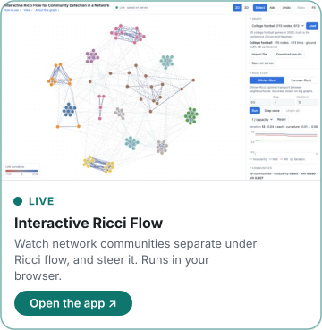
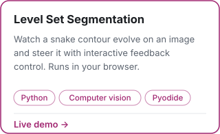

  

I break things · India

&nbsp;&nbsp;&nbsp;&nbsp;

     

## Gen AI Projects

| Project | What it does | Built with |
|---|---|---|
| [agentic_logistic_handler](https://github.com/ibipul/agentic_logistic_handler) | Describe demand, supply and other constraints in plain language; an agent frames the right optimization problem and solves it exactly with open-source tools. | Google ADK, Gemini, PuLP + CBC, FastAPI |
| [lang_chain_playground](https://github.com/ibipul/lang_chain_playground) | A LangServe role-play assistant (RAG + OpenAI) with a chat playground, runnable with one command. | LangChain, LangServe, FAISS, OpenAI |
| [InteractiveGraphVizFramework](https://github.com/ibipul/InteractiveGraphVizFramework) | Watch and steer Ricci-flow community detection on a network: load a dataset or your own edge list, run Ollivier- or Forman-Ricci flow, and see communities separate in 2D or 3D, scored against ground truth. | Python, FastAPI, NetworkX, SciPy, D3.js, Pyodide |
| [segmentation-2Dsnakes-wt-interactive-control](https://github.com/ibipul/segmentation-2Dsnakes-wt-interactive-control) | Variational 2D image segmentation (snakes) by level set evolution: Chan-Vese, Yezzi and Bhattacharya methods plus interactive feedback control, with a browser view of the contour evolving live. | Python, NumPy, SciPy, FastAPI |
| [latex2html](https://github.com/ibipul/latex2html) | Converts LaTeX documents to clean, standalone HTML in the browser, with live preview and KaTeX or MathML math. Originally a Flex and Bison parser. | Flex, Bison, JavaScript, KaTeX |

### Live demos

Each one runs in your browser; click a card to open it.

<table>
<tr>
  <td width="33%" valign="top" align="center"> <a href="https://github.com/ibipul/latex2html">Source on GitHub</a></td>
  <td width="33%" valign="top" align="center"> <a href="https://github.com/ibipul/InteractiveGraphVizFramework">Source on GitHub</a></td>
  <td width="33%" valign="top" align="center"> <a href="https://github.com/ibipul/segmentation-2Dsnakes-wt-interactive-control">Source on GitHub</a></td>
</tr>
</table>

## Other public repos

Hover over a project for a one-line summary; click to open it.

